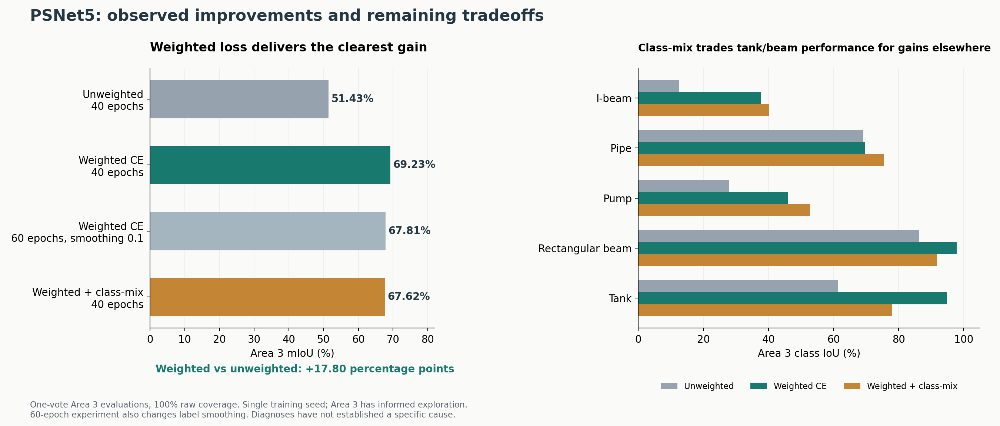

# PSNet5: current findings

Updated October 21, 2026.

## What improved the model

Class-weighted masked cross-entropy is the clearest successful change in the current experiment series. Weights were estimated only from unique voxelized training-partition class frequencies, using `1 / (frequency + 0.02)` and normalization to mean 1. Label smoothing remained 0.2. Architecture, split, seed, augmentation, optimizer and 40-epoch training duration were held fixed against the unweighted baseline. Padding remained excluded from loss.

| Metric | Unweighted baseline | Weighted CE | Change |
|---|---:|---:|---:|
| Best development-validation mIoU | 81.25% | 86.08% | +4.83 pp |
| Area 3 mIoU | 51.43% | 69.23% | +17.80 pp |
| Area 3 overall accuracy | 79.07% | 85.08% | +6.02 pp |
| Area 3 mean class recall | 60.33% | 76.79% | +16.46 pp |

All five Area 3 class IoUs improved. The largest gains included i-beam (12.44% → 37.76%) and pump (27.96% → 46.02%). The weighted checkpoint selected at epoch 39 remains the best observed Area 3 result. This is a single-seed comparison; Area 3 has already informed exploration and is no longer an untouched test set.

## What subsequent experiments showed

The later 60-epoch, smoothing-0.1 weighted run reached 67.81% Area 3 mIoU; duration and smoothing both changed. The 40-epoch class-mix run reached 67.62%. Class-mix improved i-beam, pipe and pump IoU relative to the best weighted checkpoint, but lost more on tank and rectangular beam. More rebalancing did not produce a better aggregate result.

We explored confusion matrices, paired point errors, spatial error regions, semantic-boundary proximity, vote coverage, raw-versus-subsampled weighting, projection limits, height-offset sensitivity, and exact training-sphere exposure/context. None established a specific cause of the remaining errors.

Useful observations were that errors include broad tank-wall and beam regions; small height offsets barely change validation predictions; class-mix increases pump-point exposure by 22.9% and tank exposure by 6.4%; and all training tanks come from Area 2. The height test only shifted the extra feature—it did not remove height information. Coverage/geometry descriptors and selected sphere plots do not establish object-level shape diversity or annotation correctness.

## Working interpretation

Limited diversity and difficult distinctions in the available data are a reasonable working hypothesis, especially for tanks and similar beam structures. This is not a confirmed diagnosis, and it does not prove the architecture is sufficient. The evidence does not yet justify blaming one feature, the sampler, voxel resolution, or model capacity.

Retain weighted CE as the reference. Before adding complexity, prioritize label/example review, shape/context diversity, and controlled comparisons at matched epochs. Select future changes on development validation and retain per-class metrics alongside aggregate mIoU.

## Supporting records

- [Weighted CE visual report](weighted_ce_40_report/REPORT.md) and [evaluation metrics](results/weighted_ce_epoch39_area3/summary.json).
- [Spatial error diagnosis](results/classmix_spatial_analysis/REPORT.md).
- [Height-offset experiment](results/height_sensitivity_dev/REPORT.md).
- [Training exposure and context](results/training_exposure_analysis/REPORT.md).
- [Completed report cleanup](REPORT_CLEANUP_LOG.md).
