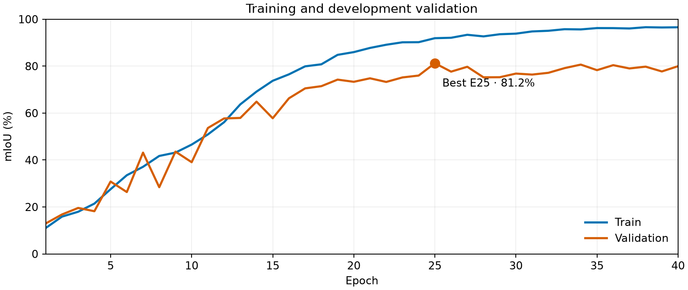
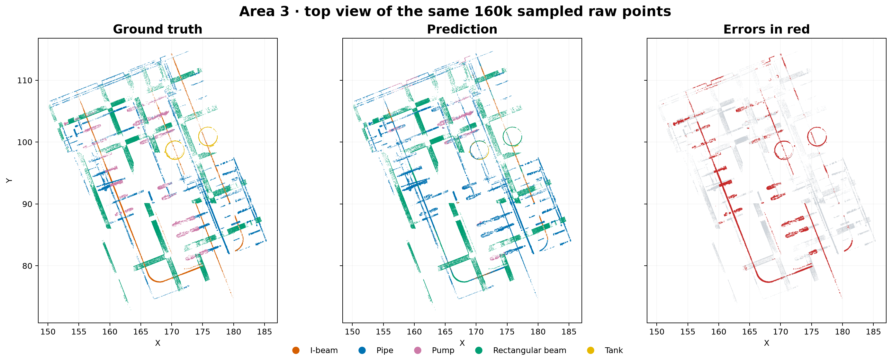
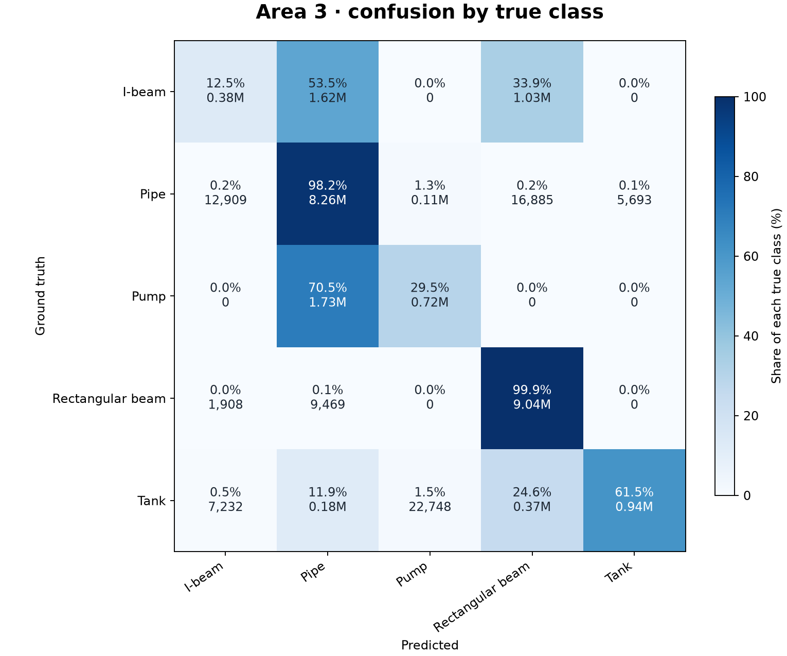

# Unweighted BatchNorm · October 5 baseline · Area 3 visual report

| Area 3 mIoU | Overall accuracy | Mean class accuracy | Coverage |
|---:|---:|---:|---:|
| **51.4%** | **79.1%** | **60.3%** | **100.0%** |

Training and development validation used spatial partitions of **Areas 1, 2 and 4**. Area 3 was evaluated separately from the saved checkpoint with **1 vote** over all raw points. Best development validation: **81.2% mIoU at epoch 25**.

This baseline run completed all **40 epochs** on October 5, 2026. Area 3 uses its **best development checkpoint (epoch 25)**. Compared with the earlier 40-epoch result (retained [evaluation metrics](../results/current_checkpoint_area3_fixed_eval/summary.json)), Area 3 mIoU decreased from **60.5% to 51.4%** (−9.1 percentage points), despite improved development validation. Pump IoU fell from 49.9% to 28.0%; I-beam recall remains low at 12.5%.

## Area 3 predictions

The top view shows the same sampled raw points in each panel. Vertical structures overlap in this projection; red marks incorrect predictions.

| Class | IoU | Recall | Main error |
|---|---:|---:|---|
| I-beam | 12.4% | 12.5% | 53.5% → pipe; 33.9% → rectangular beam |
| Pipe | 69.1% | 98.2% | — |
| Pump | 28.0% | 29.5% | 70.5% → pipe |
| Rectangular beam | 86.4% | 99.9% | — |
| Tank | 61.3% | 61.5% | — |

## BatchNorm evaluation issue

This run used current-sphere BatchNorm statistics for validation and checkpoint selection. Stored statistics produced misleading development scores for compact, variable-size spheres. The fixed mode uses each evaluation sphere's BatchNorm statistics while leaving dropout in evaluation mode and keeping running buffers unchanged. **This report's Area 3 score uses `current_batch`.** This evaluation option does not change optimizer updates.

## Sources

- [Area 3 evaluation summary](../results/batchnorm_40_fixed_eval_area3/summary.json)
- [Confusion counts](../results/batchnorm_40_fixed_eval_area3/confusion_vote_01.csv)
- [Training log](../../../log/psnet5/psnet5-train-PCM-ngpus1-20261005-173320-fEPnR2XCrEZgTem26LBB9e/psnet5-train-PCM-ngpus1-20261005-173320-fEPnR2XCrEZgTem26LBB9e.log)
