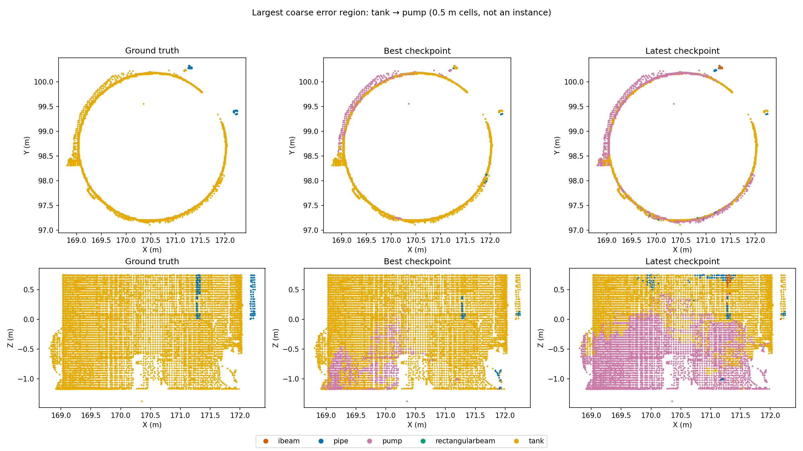
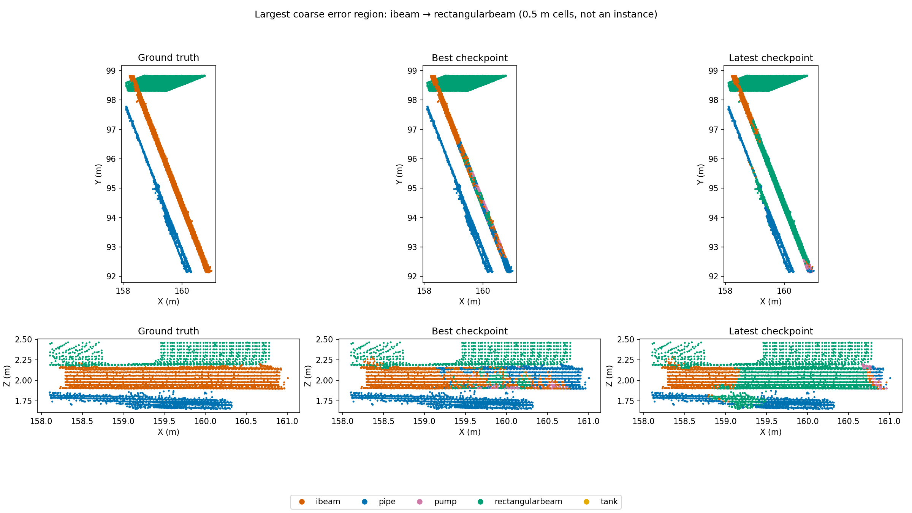

# Spatial diagnosis: class-mix versus best weighted CE checkpoint

Compared weighted CE epoch 39 (best observed Area 3 mIoU, 69.23%) with class-mix epoch 35 (67.62%). Same raw point order, labels and projection were verified. Both have 100% raw coverage and identical per-point vote counts. No weights or training settings were changed.

## Findings

### 1. Large semantic regions fail, rather than just class boundaries

Every tank→pump and tank→pipe error is more than 20 cm from another ground-truth semantic class at subsampled resolution. Median distances are 1.80 m and 1.43 m respectively. These points received medians of 14 and 16 votes. Thus a lack of votes and narrow class-boundary ambiguity do not explain this regression.

A connected set of 0.5 m error cells contains 87.1% of tank→pump errors; another contains 96.5% of tank→pipe errors (fractions measured on subsampled error points). These are spatial components, not instance annotations. The largest tank→pump crop shows extensive lower-wall patches switching to pump; the best checkpoint already makes a smaller error there.

### 2. Tank failure depends strongly on height

| Tank height band (class-specific quartiles) | Best recall | Latest recall |
|---|---:|---:|
| -1.37 to 0.06 m | 87.58% | 43.36% |
| 0.06 to 0.91 m | 99.97% | 96.76% |
| 0.91 to 1.76 m | 99.55% | 93.42% |
| 1.76 to 3.77 m | 94.26% | 72.21% |

Recall here weights each subsampled prediction by the number of raw points projected to it. The model explicitly receives absolute Z, so height dependence is a useful lead. It does not establish reliance on height: object identity, geometry and height are correlated. A diagnostic height-feature ablation is needed before changing this feature.

### 3. I-beam confusion is coherent along the structure

92.8% of latest i-beam→rectangularbeam errors are more than 20 cm from another semantic class. The largest coarse component holds 55.1% of these subsampled errors. The crop shows a long section being assigned rectangular beam, rather than a thin fringe. The baseline also struggles on this section, but its predictions differ.

### 4. Raw density reverses the model ranking

| Point weighting | Best mIoU | Latest mIoU | Change |
|---|---:|---:|---:|
| Raw-point benchmark | 69.23% | 67.62% | -1.60 pp |
| Equal weight per represented subsampled point | 71.95% | 72.60% | +0.65 pp |

The latest model is better under approximately uniform spatial sampling but worse under the raw benchmark distribution. This is not a projection bug: the projections and vote counts match exactly. It means the placement of errors relative to scan density matters. For example, i-beam→rectangularbeam affects 3,691 represented subsampled points but 692,800 raw points. Report both metrics during subsequent experiments, while selecting against the intended benchmark metric.

Assigning each projection cell its majority raw ground-truth label achieves 99.92% mIoU and 99.967% accuracy. Pure label mixing/projection aliasing therefore cannot account for the observed 32-point mIoU deficit. This oracle does not test whether voxelization removes geometric features needed to infer labels; finer resolution could still help recognition.

### 5. The sampler did not simply stop visiting tanks

Training-center counts for the first 40 epochs (80,000 spheres; batch size two gives 1,000 optimizer steps per epoch):

| Center class | Spatial sampler | Class-mix sampler |
|---|---:|---:|
| ibeam | 5,930 | 5,877 |
| pipe | 40,407 | 38,903 |
| pump | 2,961 | 3,984 |
| rectangularbeam | 27,441 | 27,219 |
| tank | 3,261 | 4,017 |

Tank centers increased by 23.2%, and pump centers by 34.5%. A center label is not the same as total class-point exposure; spatial coverage and context composition may still change. The class-mix schedule exposes 33,629,910 valid tank points over these 40 scheduled epochs, counting repeated visits. A matching baseline point-exposure total was not reconstructed.

## Consequences for the next experiment

1. Keep the strongest weighted CE checkpoint as the reference. Add per-class raw and subsampled validation metrics, height bands, and interior-versus-boundary recall to the experiment report. Do not optimize only one aggregate score.
2. First run a controlled sampling experiment: class-mix ratio 0.10 versus 0.00, keeping loss, seed, duration and model fixed. The current ratio helps pumps but redistributes errors on tanks and beams; a smaller ratio is a testable compromise, not a proven fix.
3. Diagnose height dependence with inference perturbations of only the height feature on development validation, preserving XYZ geometry. Compare baseline and class-mix response. If fragility is clear, test local/area-relative height or height-feature dropout in a separate training ablation.
4. If tank interiors remain weak, test multiscale context while retaining fine local features. The evidence supports testing broader context; it does not yet prove that the current 2 m sphere is too small.
5. Before paying for globally finer voxels, inspect beam cross-sections in targeted high-resolution crops. The current oracle makes boundary cleanup a lower-priority experiment.

## Scope and limits

Boundary proximity means Euclidean distance to the closest differently labelled subsampled point, not a physical surface edge or an instance boundary. Spatial components use 26-neighbor connectivity of occupied 0.5 m cells and may merge nearby objects. Visualization uses deterministic point samples. 214 of 532,637 subsampled points have no projected raw point, so their predictions cannot be recovered from the saved exports and they are excluded from spatial metrics; all 24,466,092 raw points are retained.

The analysis compares two selected checkpoints from single-seed runs. It identifies error structure, not the causal effect of the sampler. Development-validation spatial prediction exports were not available, so these diagnostics have not yet been replicated there. Area 3 has already influenced exploration and should not be used to choose among the next ablations.

Artifacts: [numerical summary](summary.json), [semantic proximity](semantic_proximity.csv), [vote/density bins](sampling_density.csv), [clusters and bounding boxes](error_clusters.csv), [height bands](height_quartiles.csv), [training centers](training_centers.json), [full overview](overview.png).
