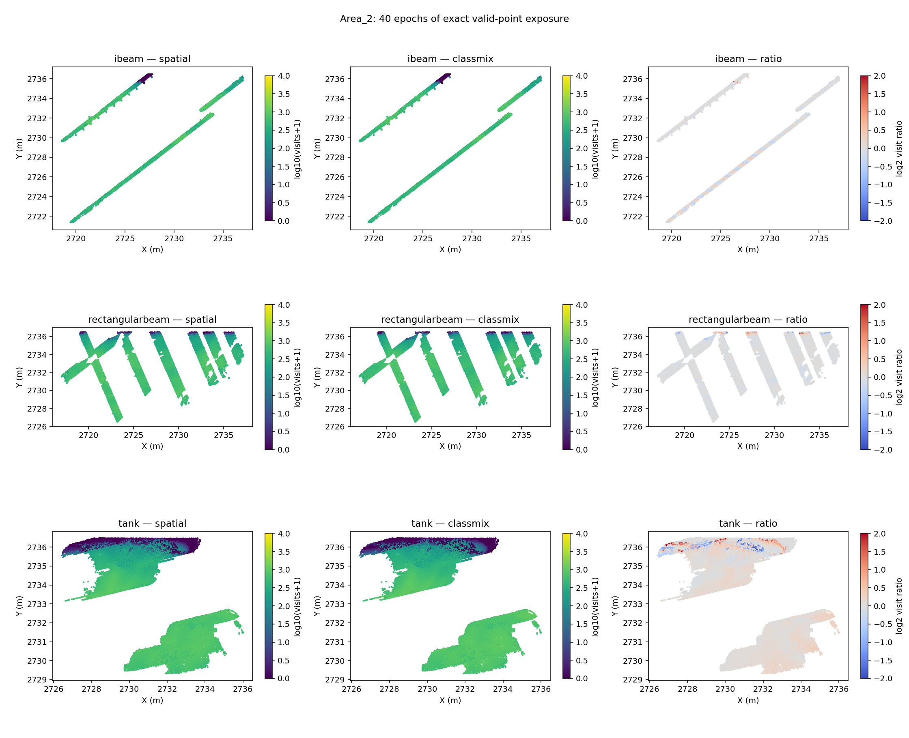
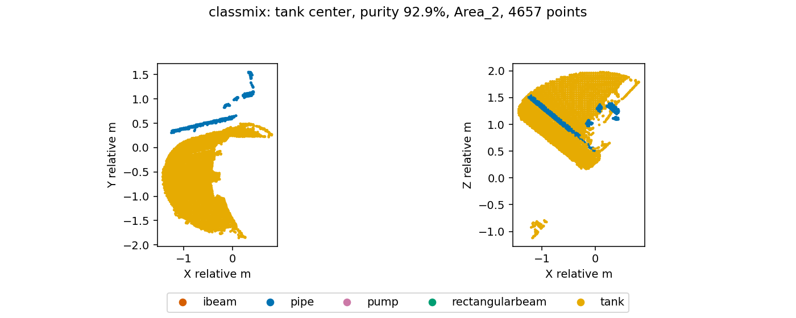
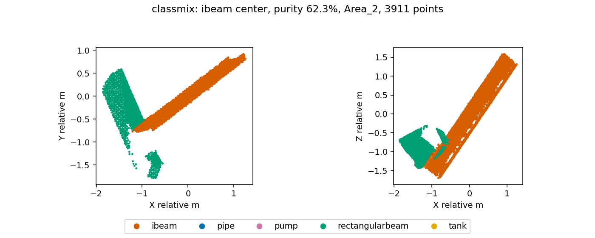

# Training exposure, geometry and context analysis

Replayed all 80,000 cached training spheres for each sampler (40 epochs). Used exact cached centers/jitter, the assigned training partition, radius 2 m, nearest-15,000 valid-point cap, and excluded padding. The mixed sampler totals match its pre-existing diagnostic exactly. No model weights were changed and no training was launched.

## What class-mix actually changes

| Class | Spatial valid-point visits | Class-mix valid-point visits | Change |
|---|---:|---:|---:|
| ibeam | 17,916,466 | 17,599,779 | -1.77% |
| pipe | 190,808,154 | 188,546,662 | -1.19% |
| pump | 14,694,240 | 18,065,331 | +22.94% |
| rectangularbeam | 140,740,862 | 138,672,136 | -1.47% |
| tank | 31,599,620 | 33,629,910 | +6.43% |

The strongest effect is extra pump exposure, consistent with the pump recall gain. Tank exposure increases modestly despite 23.2% more tank centers: center class is not the same as the class composition of a sphere. The tank-center mean composition is almost unchanged (86.77% tank before, 86.73% after; roughly 12% pipe in both). I-beam-centered spheres remain about 65% i-beam and 34% rectangular beam. There is no large shift in mean context composition for these centers.

## Coverage becomes slightly less complete for tanks

Area 2 contains all training tanks. Of 67,651 subsampled tank points:

| Quantity | Spatial | Class-mix |
|---|---:|---:|
| Never visited (%) | 10.71 | 11.74 |
| Mean visits per point | 467.10 | 497.11 |
| Median visits per point | 557.00 | 588.00 |

Class-mix loses coverage of 1,264 tank points that spatial sampling visits, while gaining 568 other tank points. Every never-visited tank point is within 0.84 m of the train/validation boundary. Centers must stay 2 m back from that boundary; point inclusion depends on the radius and center jitter. This is a boundary-buffer coverage limitation, not evidence of losing an entire tank type. Away from this fringe, tank exposure is already hundreds of visits per point.

At the selected checkpoints (spatial epoch 39, mixed epoch 35), cumulative tank exposure is 30,796,060 versus 29,444,212 visits: the mixed checkpoint has actually seen 4.39% fewer tank-point presentations because it was selected earlier. This is an additional confound; the equal-40-epoch table isolates schedule exposure more fairly.

## What geometric/context examples are being shown

Tanks exist in one training area and one annotation source (`Area_2/.../tank_OSCG.txt`). Area 3 uses `tank_SPH.txt`. These are source files, not object-instance annotations; one file may contain multiple physical tanks. Additional center selections do not create new shapes or source diversity. Training plots show cylindrical/curved wall patches and nearby pipes.

For beams, center neighborhoods frequently contain both i-beam and rectangular beam. Local 16-neighbor same-class PCA descriptors were measured for line-like and surface-like patches. Their exposure mix changes little: there is no evidence here that class-mix selectively stopped showing one broad beam-shape category. This descriptor is a coarse local proxy, not a measurement of flange/web topology or complete cross-section visibility.

## How failed Area 3 regions differ in local context

For each category below, up to 1,000 deterministic subsampled centers were queried with the same 2 m radius and 15,000-point cap. Centers are on object surfaces, are not jittered, and are not drawn from the training potential schedule. This is a context diagnostic, not a matched experimental comparison.

| True → prediction | Median own-class fraction | Median valid points | Fraction of >99% pure spheres |
|---|---:|---:|---:|
| tank → tank | 97.5% | 8995 | 36.7% |
| tank → pump | 99.0% | 8556 | 50.2% |
| tank → pipe | 98.0% | 9646 | 15.4% |
| ibeam → ibeam | 37.9% | 4810 | 16.7% |
| ibeam → rectangularbeam | 44.4% | 3842 | 18.2% |
| ibeam → pipe | 97.1% | 2116 | 42.9% |

A semantic boundary is not required for the tank errors: failed wall regions can provide predominantly tank-labelled context and still be predicted as pump/pipe. Label purity alone does not guarantee enough distinctive geometry, and does not identify the causal feature.

## What this supports changing

1. First address training coverage diagnostics: log unique-point coverage and missed points by class and distance to the split boundary, rather than only center counts. Any coverage-preserving sampler change must respect the fixed partition; do not allow training spheres to cross into validation.
2. To retain the useful pump gain, compare a lower mixed ratio (0.10) with the spatial baseline under otherwise fixed settings and inspect tank/beam validation recall. The exact exposure result supports a smaller intervention; it does not prove that lowering the ratio fixes the failure.
3. Tank diversity is limited to Area 2 in both training and validation. Prioritize augmentations or multiscale contexts that vary tank partial views and surrounding pipes, with a controlled development-validation experiment. Extra visits to already well-covered patches alone will not add new tank examples.
4. For beam confusion, measure visibility of cross-section details in local crops before increasing resolution. Exposure is broadly preserved, so reduced beam visitation alone is an inadequate explanation for a large IoU drop.
5. Compare checkpoints at matched epochs as well as their best validation epochs before attributing differences to the sampler. These two single-seed selected checkpoints cannot establish causal effects.

No evidence here justifies immediately replacing the architecture. The concrete findings are a pump-heavy exposure shift, a tank boundary-coverage tradeoff, limited tank-source diversity, and an earlier selected mixed checkpoint.

## Artifacts

[Exact per-point exposure](point_exposure.csv), [all sphere contexts](sphere_context.csv), [spatial cell totals](spatial_cells.csv), [local geometry exposure](geometry_exposure.csv), [target context diagnostics](target_context.json), [missed-point boundary distances](unseen_split_proximity.json), [summary and selected sphere images](summary.json). Per-area NPZs hold visit counts aligned to the training cache points.
