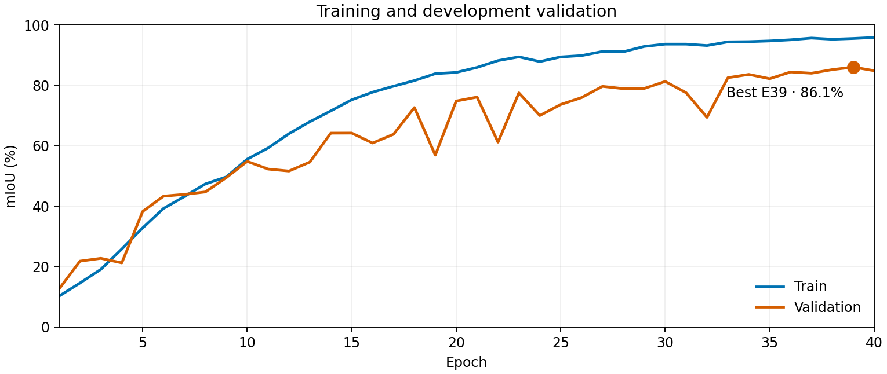
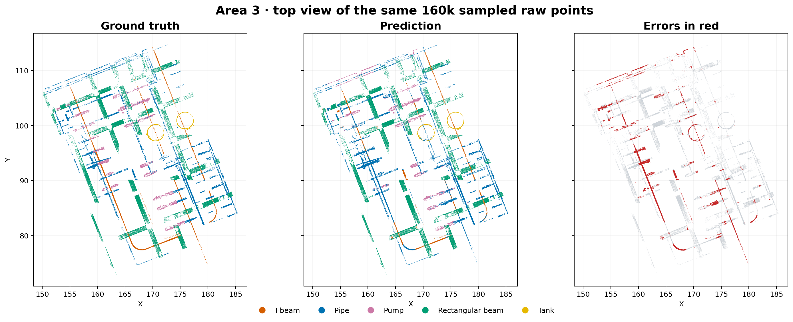
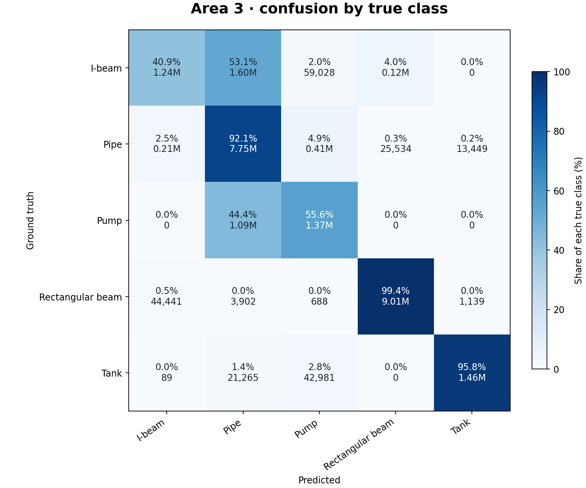

# Weighted cross-entropy · 40 epochs · Area 3 visual report

| Area 3 mIoU | Overall accuracy | Mean class accuracy | Coverage |
|---:|---:|---:|---:|
| **69.2%** | **85.1%** | **76.8%** | **100.0%** |

Training and development validation used spatial partitions of **Areas 1, 2 and 4**. Area 3 was evaluated separately from the saved checkpoint with **1 vote** over all raw points. Best development validation: **86.1% mIoU at epoch 39**.

## Training duration and loss change

The 40 training epochs and their development validation took **5 hours, 5 minutes, 31 seconds** (log timestamps 01:32:55–06:38:26). Including the final re-evaluation of the best development checkpoint, the full job took **5 hours, 7 minutes, 51 seconds** (ending 06:40:46). This excludes the preceding smoke test and the separate Area 3 evaluation. Average time per epoch, including validation, was **7 minutes, 38 seconds**. Hardware: NVIDIA GeForce RTX 3060.

The experiment enabled class-weighted masked cross-entropy while retaining **label smoothing 0.2**, seed **20261004**, the 40-epoch duration, and the baseline architecture, data split, augmentation and optimizer settings. Weights came only from voxelized training partition frequencies: `1 / (frequency + 0.02)`, normalized to mean 1. In class order they were **[1.6772, 0.2686, 1.7393, 0.3240, 0.9909]**. Padding remains excluded from loss.

## Improvement over the unweighted 40-epoch baseline

| Metric | Unweighted | Weighted CE | Change |
|---|---:|---:|---:|
| Best development mIoU | 81.25% | 86.08% | +4.83 pp |
| Area 3 mIoU | 51.43% | 69.23% | +17.80 pp |
| Area 3 overall accuracy | 79.07% | 85.08% | +6.02 pp |
| Area 3 mean class recall | 60.33% | 76.79% | +16.46 pp |

| Class | Baseline IoU | Weighted IoU | Change | Baseline recall | Weighted recall | Weighted precision |
|---|---:|---:|---:|---:|---:|---:|
| ibeam | 12.44% | 37.76% | +25.32 pp | 12.53% | 40.94% | 82.91% |
| pipe | 69.13% | 69.63% | +0.50 pp | 98.23% | 92.14% | 74.03% |
| pump | 27.96% | 46.02% | +18.06 pp | 29.51% | 55.65% | 72.67% |
| rectangularbeam | 86.36% | 97.85% | +11.50 pp | 99.87% | 99.45% | 98.39% |
| tank | 61.26% | 94.87% | +33.60 pp | 61.49% | 95.78% | 99.01% |

All five class IoUs improved. I-beam and pump recall increased substantially, with precision decreasing from 94.50% to 82.91% and from 84.21% to 72.67%, respectively. Pipe recall fell from 98.23% to 92.14%, but its IoU rose slightly. Weighting is promising in this single-seed comparison; repeated seeds are needed to estimate variability. Area 3 has already informed this exploration, so it is no longer an untouched holdout.

The comparison uses one vote, current-sphere BatchNorm statistics and full raw-point coverage for both runs. See the [unweighted baseline report](../batchnorm_40_report/REPORT.md).

## Area 3 predictions

The top view shows the same sampled raw points in each panel. Vertical structures overlap in this projection; red marks incorrect predictions.

| Class | IoU | Recall | Main error |
|---|---:|---:|---|
| I-beam | 37.8% | 40.9% | 53.1% → pipe; 4.0% → rectangular beam |
| Pipe | 69.6% | 92.1% | — |
| Pump | 46.0% | 55.6% | 44.4% → pipe |
| Rectangular beam | 97.9% | 99.4% | — |
| Tank | 94.9% | 95.8% | — |

## BatchNorm evaluation issue

This run used current-sphere BatchNorm statistics for validation and checkpoint selection. Stored statistics produced misleading development scores for compact, variable-size spheres. The fixed mode uses each evaluation sphere's BatchNorm statistics while leaving dropout in evaluation mode and keeping running buffers unchanged. **This report's Area 3 score uses `current_batch`.** This evaluation option does not change optimizer updates.

## Sources

- [Area 3 evaluation summary](../results/weighted_ce_epoch39_area3/summary.json)
- [Confusion counts](../results/weighted_ce_epoch39_area3/confusion_vote_01.csv)
- [Training log](../../../log/psnet5/psnet5-train-PCM-ce-weighted-ngpus1-20261014-013255-RYxnShfJR67zVkme9fdFat/psnet5-train-PCM-ce-weighted-ngpus1-20261014-013255-RYxnShfJR67zVkme9fdFat.log)
